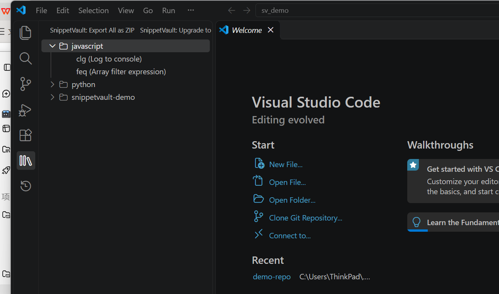

# SnippetVault — Local Snippet Manager for VS Code

> Never lose a code snippet again. Organized locally. Search instantly.

## Overview

SnippetVault gives you a clean graphical interface inside VS Code to manage your snippets — no more hunting through thousands of lines of raw JSON. Everything stays on your machine. Zero uploads, zero tracking.



## Features

### Free Tier (up to 100 snippets)
- **Tree-view panel** — group your snippets by language or project, collapsible folders
- **Instant search** — matches against prefix, description, and body content in real time
- **Inline preview & edit** — click any snippet to open a clean editor panel
- **One-click insert** — use `Ctrl+Space` to insert the selected snippet into your active file
- **ZIP export** — bundle all snippets (JSON + README) for backup or sharing

### Pro Tier ($7 one-time lifetime)
- Unlimited snippets (no 100-limit cap)
- ZIP import — restore from backup across machines [Phase 2 - Upcoming]
- Advanced search: fuzzy matching + regex support [Phase 2 - Upcoming]
- Tag system [Phase 2 - Upcoming]
- Cross-device sync instructions [Phase 2 - Upcoming]

## Installation

1. Open VS Code → Extensions (`Ctrl+Shift+X`)
2. Search for **"SnippetVault"** by **LxStudio**
3. Click Install

Or install from the `.vsix` package:
```bash
code --install-extension snippetvault-lx-1.0.0.vsix
```

## Usage

### Opening the Manager
- Click the SnippetVault icon in the activity bar, or
- Command Palette → `SnippetVault: Open Manager`

### Inserting a Snippet
1. Select a snippet in the tree view
2. Press `Ctrl+Space` in any editor to insert it at cursor position

### Editing a Snippet
Click any snippet in the tree to open the edit panel. Modify the description or body, then click **Save**.

### Exporting Snippets
Command Palette → `SnippetVault: Export All as ZIP` — downloads a `.zip` containing all your snippet JSON files plus a human-readable README.

### Upgrading to Pro
1. Set your Paddle payment link in settings (`snippetvault.buyoutLink`)
2. Command Palette → `SnippetVault: Upgrade to Pro` — opens browser checkout
3. Paste your license key → `SnippetVault: Activate Pro`

## Configuration

| Setting | Default | Description |
|---|---|---|
| `snippetvault.verifyEndpoint` | `https://snapmark-license.61960005.workers.dev/verify` | License verification endpoint |
| `snippetvault.buyoutLink` | `https://snapmark-b2-checkout.pages.dev/?priceId=pri_01m7pn3zx66e4sayrywrdkv3d6` | Paddle checkout link for Pro upgrade ($7 one-time) |

## Privacy

SnippetVault is local-first by design:
- No telemetry, analytics, or crash reports
- No data uploaded during normal operation
- Only network call: POST `/verify` when activating Pro license (license key only, nothing else)

See [Privacy Policy](privacy-policy.html) for details.

## License

MIT License — see [LICENSE.md](LICENSE.md).

## Support

Questions? Bug reports? Email [support@lxstudio.app](mailto:support@lxstudio.app).

---

**Built with ❤️ by LxStudio**
